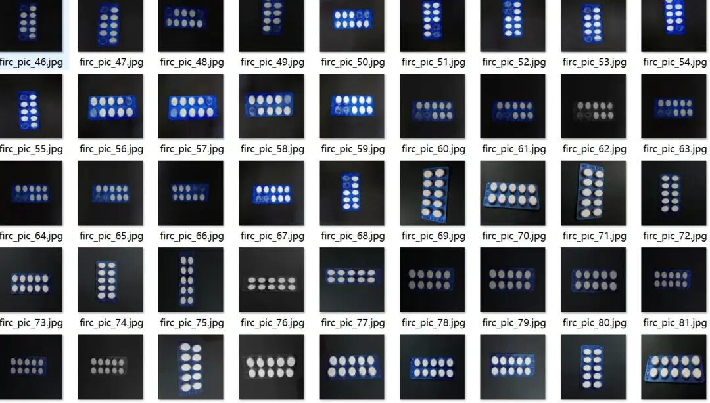
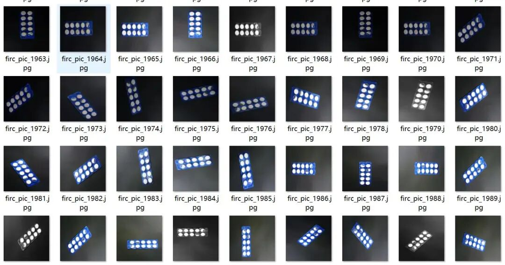
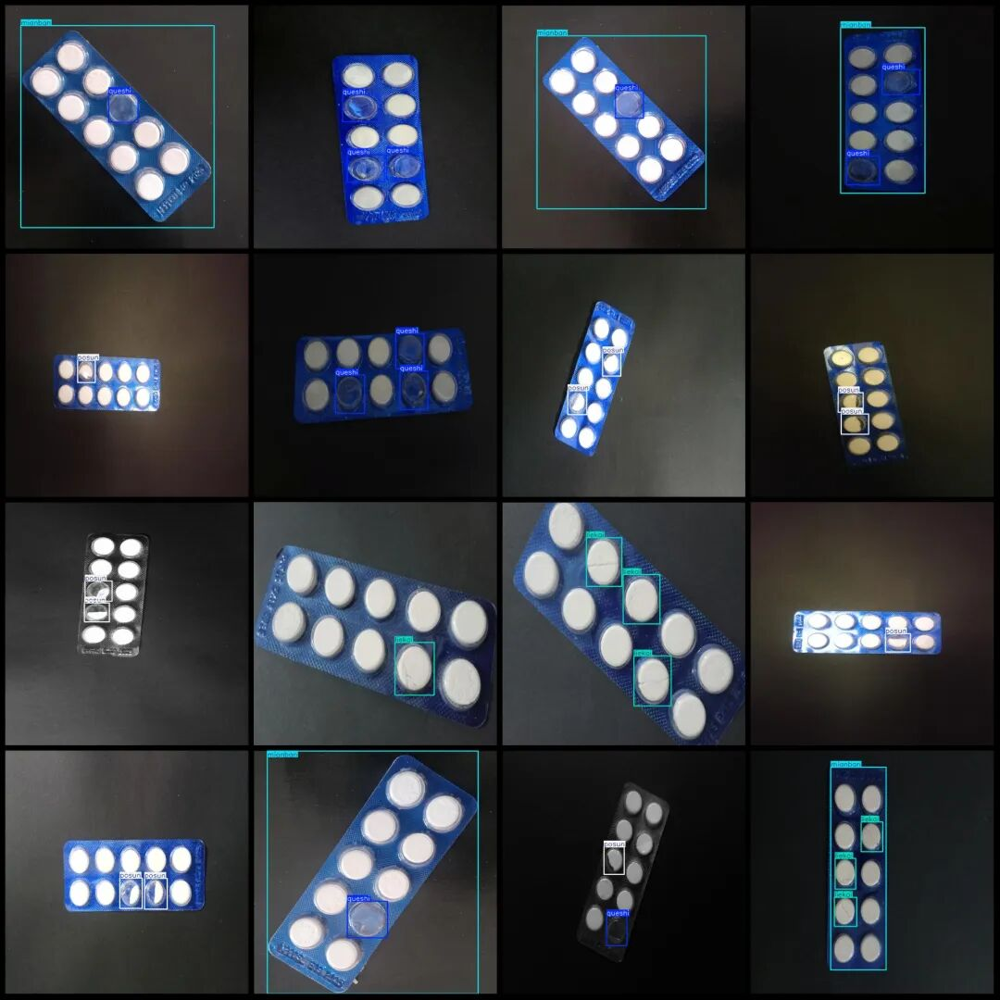
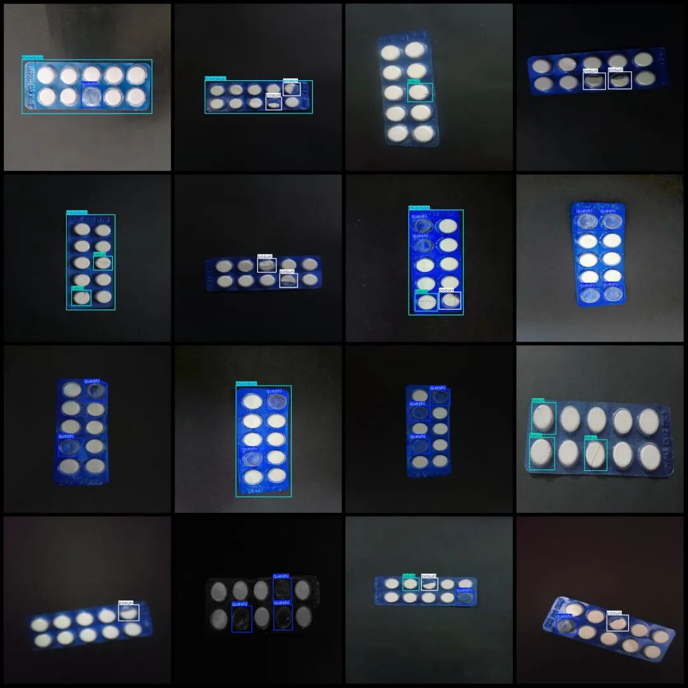

# Intelligent Medical Blister Tablet Missing and Broken Detection Dataset VOC+YOLO format with 2375 images in 4 categories

Please note that approximately 850 out of the dataset are original images, while the remaining are enhanced ones.

Dataset format: Pascal VOC format + YOLO format (txt file without split path, only containing jpg images and corresponding VOC format xml files and yolo format txt files)

Number of images (number of jpg files): 2375

Number of annotations (number of xml files): 2375

Number of annotations (number of txt files): 2375

Labeling category count: 4

Label category names (Note that the order of categories in the YOLO format does not correspond to this, but is based on the labels folder's classes.txt): ["liekai", "mianban", "posun", "queshi"]

Number of boxes labeled in each category:

Liekai (Crane) frame count = 1679, occupying picture count = 1052.

Number of panels (mianban) = 1177, Number of images occupied = 1176

Posun (broken) frame count = 1259, occupying image count = 941

Quesshi (missing) frame count = 1803, occupying image count = 842.

Total frame count: 5918

Image resolution: 720x720

Using labelImg:

Annotation rules: Draw a rectangle around the category.

Important Notice: The dataset does not have separate training, validation, and test sets; you need to partition them yourself.

Special : This dataset does not guarantee the accuracy of the trained models or weight files.

Image Preview:

Annotation example:

## Payment

Here is a pay link on Stripe ( https://buy.stripe.com/3cs8yP7sY87d0vu9AB ). Please contact me lonlonago@foxmail.com after funding $89, and I will send you a complete data files , thank you!

